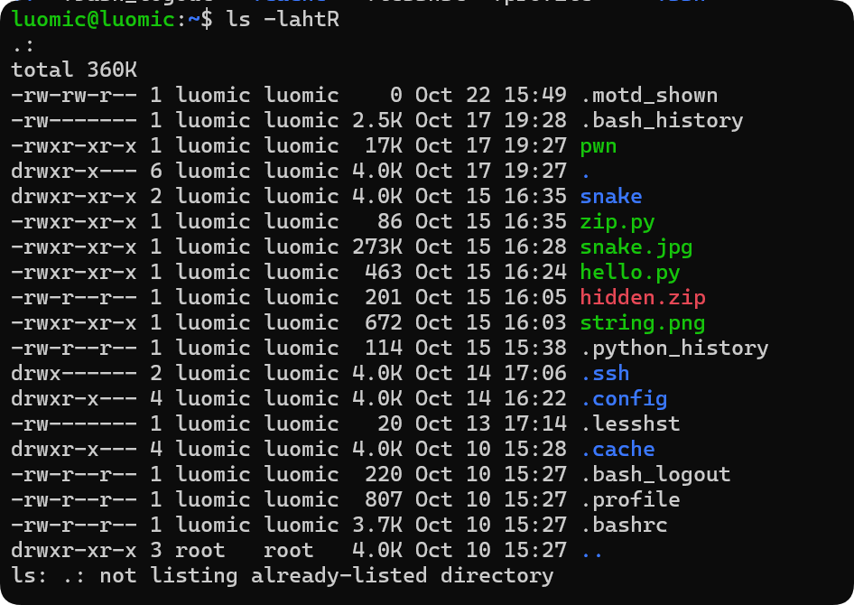

> 随便记录一下学习Linux和Python的日记

# Linux与命令

在PowerShell中安装WSL即可获得其内置的Linux子系统（仅针对Windows 10/11 系统）

## 基础命令：

| 命令    | 作用           | 示例                | 输出                 |
| ----- | ------------ | ----------------- | ------------------ |
| `pwd` | 查看当前进程目录     | `pwd`             | `/home/luomic`     |
| `cd`  | 切换工作目录       | `cd /mnt/c/user/` | C盘                 |
| `ls`  | 列出当前目录下的所有文件 | `ls -a`           | xxx.txt  basic.zip |



## 二进制

学习 Linux 的命令离不开二进制和十六进制.

比如十进制 $100$ 的二进制表达式：$100 = 2^6 + 2^5 + 2^2$

在 $2$ 的指数上可以直观的看出来，也就是：

$$
6~~~~5~~~~4~~~~3~~~~2~~~~1~~~~0
$$
$$
1~~~~1~~~~0~~~~0~~~~1~~~~0~~~~0
$$

那么 $100_{10}$ 就是 $1100100_{2}$

换句话说，只要知道了一个数他是对 $2$ 的一系列某次方累加，在对应“区域”标上一个 $1$ 即可，常以 0b 开头 .

## 十六进制 Hex

十六进制以十六个符号表示数字 :
$$
0\quad1\quad1\quad2\quad3\quad4\quad5\quad6\quad7\quad8\quad9\quad A\quad B\quad C\quad D\quad E\quad F
$$
十六进制常以 0x 开头.

### 十六进制与二进制的转换

以四位分割，不足四位则在左边补上 $0$
例如：0x64

$6_{10} = 2^2 + 2^1\Rightarrow 0110_2$

$4_{10} = 2^2 \Rightarrow 0100_2$

0x64 = $01100100 = 1100100$

### 十六进制与十进制的转换

$100=6\times 16^1+4\times 16^0\Rightarrow$ 0x64

也可以除以16取余数：

$100\div 16=6\dots4$

$4\div 16=0\dots 4$

得到$100_{10}=$ 0x64

## 重要命令

注意真实命令不带`[]`

| 命令        | 示例                                       | 输出          | 备注                              |
| --------- | ---------------------------------------- | ----------- | ------------------------------- |
| `grep`    | `grep [content] [file name]`             | 该行文本内容      |                                 |
| `find`    | `find -size [1024c] -name ["error.txt"]` | 查找到的文件名     | 支持通配符`*`                        |
| `cat`     | `cat [file name]`                        | 文件内容        |                                 |
| `file`    | `file [file name]`                       | 文件属性        | 例如`ASCII Text`                  |
| `strings` | `strings [file name]`                    | 强制转换成字符串的文本 |                                 |
| `mv`      | `mv [file 1] [file 2]`                   | /           | 重命名文件(夹)<br>`file 2`存在则为移动文件(夹) |
| `cp`      | `cp [file] [path]`                       | /           | 把文件复制到`path`下                   |
| `tar/gz`  | `tar xf a.tar`                           | /           | 解压文件,若为`gzip`,`bzip2`则会删除源文件    |
| `xxd`     | `xxd -r [file 1] > [file 2]`             | /           | 将十六进制文件转二进制文件                   |

如果文件(夹)包含`-`需要显式声明`./-`

## 输入与输出

### STDOUT

即`Linux`中的 `>`or `>>`,它将命令的输出返回到一个文件中.

它们的区别是`>`会覆盖内容,而`>>`则是追加新内容,并非覆盖

```bash
ls > all.txt
cat all.txt
a
b
c

# 新开一个终端,假设a.txt已有部分内容:111
ls >> all.txt
cat all.txt
111
a
b
c
```
### STDIN

即`<`将内容传入到命令中

```bash
wc -l < all.txt
7
```
## 管道

管道只传`STDOUT`,用`|`来分割这些命令.

```bash
ls | grep txt
```

注意`find`命令的`-exec [command] {} \`与管道并非同一种东西.

管道传`STDIN`和`STDOUT`,而`exec`传的是命令参数.