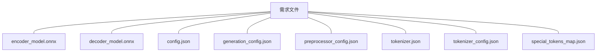

# 安卓开发的学习博客

## 前言

> 最近想着将自己的一些想法，转换为便捷、可操作的一些应用程序
> 其中就包括基于`ONNX Runtime`快速输出`Latex`数学块、基于`llama.cpp`离线运行本地量化翻译模型。
> 关于这方面技术和生态都比较成熟，底层架构涉及知识盲区，不作讨论。

首先在 `build.gradle` 引入 `OONX Runtime`

```kts
dependencies {
    implementation("com.microsoft.onnxruntime:onnxruntime-android:1.19.0")
}
```

> 注意需要先去 `HuggingFace` 等网站，寻找适配的 `onnx` 模型。

一个完整的识别模型一般包含以下文件



## kt 大致框架（也可以直接在MainActivity完成所有逻辑）

- MainActivity(主界面)
- Canvas(手写画布逻辑)
- ToBitmap(Canvas转位图)
- LatexPreview(Latex预览)
- Tokenizer(编码解码ONNX的输出)
- FormularRecognizer(识别器)


## 大致代码流程

```kt
LaunchedEffect(strokes.size, recognizer) {

        val r = recognizer ?: return@LaunchedEffect

        if (strokes.isEmpty()) return@LaunchedEffect

        delay(700)

        val bmp = strokesToBitmap(strokes.toList()) ?: return@LaunchedEffect

        status = "识别中…"

        try {

            val t0 = System.currentTimeMillis()

            val result = withContext(Dispatchers.Default) { r.recognize(bmp) }

            latex = result

            status = "完成，用时 ${System.currentTimeMillis() - t0} ms"

        } catch (e: CancellationException) {

            throw e

        } catch (e: Throwable) {

            status = "识别失败：${e.message}"

        }

    }
```